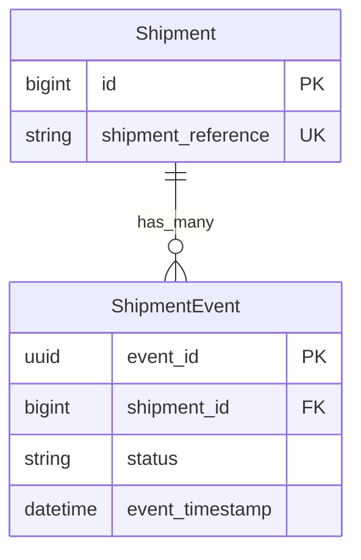

# Shipment Event Service — Technical Design

## Goal and scope

Build a small Rails service backed by PostgreSQL that ingests carrier tracking events, tolerates duplicate and out-of-order delivery, and returns an accurate shipment timeline and current status. The end-to-end local demo includes a read-only browser UI for inspecting and filtering individual events. Authentication, deployment, Sidekiq, asynchronous processing, and downstream event publishing are out of scope.

## Correctness invariants

1. The carrier-provided UUID `event_id` is the event primary key and idempotency key. For this single-carrier exercise it is globally unique; a multi-carrier system may need uniqueness scoped by carrier.
2. An exact replay is a successful no-op. Reusing an ID with different immutable fields is rejected with `409 Conflict`; it never overwrites the original event.
3. Current status is derived by logical lifecycle rank: `created < picked_up < in_transit < delivered | failed`. A late lower-rank event cannot regress state. Forward skips are allowed because carriers may omit intermediate milestones.
4. `delivered` and `failed` are mutually exclusive terminal branches at the same rank. If both are observed for a shipment, retain both raw events, set `current_status` to `null`, and expose the resolution as `undetermined` instead of inventing a winner. The supplied fixture has no such conflict.
5. The timeline contains every accepted event once and is ordered by `(event_timestamp, event_id)` ascending; time orders history, not lifecycle state.
6. Database constraints, rather than an application-side “check then insert,” enforce event and shipment uniqueness under concurrent requests.

## Data model and indexes

`Shipment` has a unique, non-null `shipment_reference` and many `ShipmentEvent` records. `ShipmentEvent.event_id` is a UUID primary key; each event also has a required `shipment_id` foreign key, `status`, and timezone-aware `event_timestamp`.

The primary key supplies the unique event-ID index. Add a unique index on `shipment_reference` for shipment lookup and a non-unique index on `shipment_id` for fetching a shipment’s events. Keep `ORDER BY event_timestamp, event_id` in SQL; with fewer than five events per shipment, the database can cheaply sort each small result set. Do not add a timestamp or composite timeline index for this fixture. The operator's partial-reference `ILIKE '%term%'` filter cannot use the ordinary B-tree reference index for substring search; at the current 941-event scale, scan the small joined result set, and consider a measured `pg_trgm` index if this search becomes a bottleneck. If realistic `EXPLAIN ANALYZE` results at larger volume show a timeline benefit, consider `(shipment_id, event_timestamp, event_id)`. Current status is derived from raw event statuses; do not add a mutable status cache at this fixture size. If read volume later justifies a projection, keep it rebuildable and update it transactionally.

## Ingestion and query API

`POST /webhooks/carrier_events` accepts JSON with `event_id`, `shipment_reference`, `status`, and ISO-8601 `event_timestamp`. Validate required fields, UUID/timestamp parsing, and allowed statuses. In a database transaction, find or create the shipment and insert the event subject to the primary-key constraint. If the event ID already exists, compare immutable fields: return an idempotent success for an exact replay, or `409 Conflict` for a payload mismatch. Return a clear validation error for malformed input.

`GET /shipments/:shipment_reference` returns the shipment, its events in timestamp order, and current status derived by lifecycle rank. For contradictory terminal branches, return `current_status: null` and `status_resolution: "undetermined"`. `GET /shipments?status=...` filters on the derived shipment status; support `status=undetermined` so consumers can find conflicts. `GET /shipment_events?shipment_reference=...&status=...` returns individual event rows for the operator table, combining a case-insensitive shipment-reference substring filter with an event-level status filter; order by `(event_timestamp, event_id)` descending. The `undetermined` shipment status is not an event status. Shipments with no events are not created by the webhook flow. Keep response shapes small and stable for the demo.

## Replay and verification

A Ruby replay script reads the included CSV from `data/carrier_events.csv` relative to the repository root and accepts a path override for alternate fixtures. Send events to the local endpoint with bounded concurrency, report sent/duplicate/error counts, and fail on unexpected HTTP errors. After replay, independently deduplicate by event ID, verify each shipment’s returned event IDs and timestamp ordering, and compare current status with the highest logical lifecycle rank. Re-running the replay must not change event counts, timelines, or status.

Use Rails’ built-in Minitest for request-level coverage of exact duplicate ingestion, conflicting duplicate IDs, out-of-order lifecycle events, and the separation between timeline time order and status rank. Also cover status filtering, including `undetermined`, and assert that contradictory terminal events are retained while current status is null. The demo is not complete until migrations, tests, a full replay, and documented curl examples pass against PostgreSQL.

## Async evolution (design only)

If ingestion volume or carrier latency later requires asynchronous processing, keep the webhook thin: validate and durably record accepted input, then hand off internal processing through a transactional outbox or equivalent durable queue boundary. Workers process at least once, remain idempotent on `event_id`, retry transient failures with backoff, and route exhausted failures to a dead-letter queue for inspection/replay. This is an internal processing design, not publication of events to downstream consumers. Preserve the event log as truth and make any future status projection rebuildable. The initial demo deliberately avoids this infrastructure so its correctness path stays observable and easy to explain.

## Fixture location

The supplied CSV is included at `data/carrier_events.csv` in the repository root. The replay script uses this file by default and accepts an explicit path override for other local fixtures.
